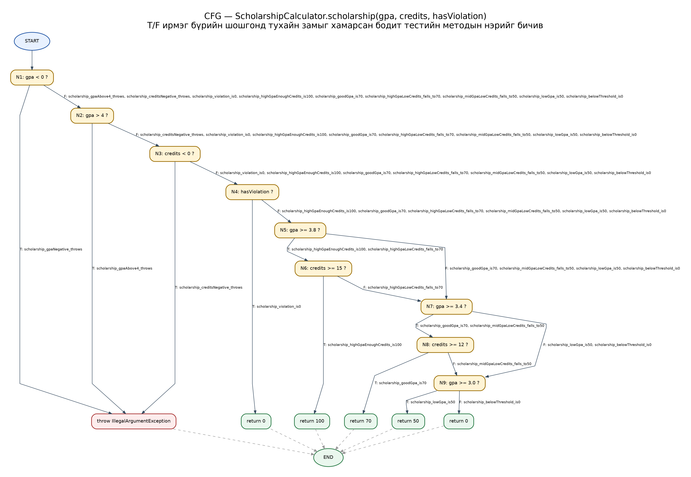

# Lab 09: JaCoCo code coverage

Нэр: Ц.Мөнхжин
Оюутны код: B232270034

## Орчин

```
openjdk version "21.0.13" 2026-10-20
OpenJDK Runtime Environment (build 21.0.13+9-1-deb13u2-Debian)
OpenJDK 64-Bit Server VM (build 21.0.13+9-1-deb13u2-Debian, mixed mode, sharing)
Apache Maven 3.9.9
Maven home: /usr/share/maven
Java version: 21.0.13, vendor: Debian, runtime: /usr/lib/jvm/java-21-openjdk-amd64
Default locale: en_HK, platform encoding: UTF-8
OS name: "linux", version: "6.12.115+deb13.1-amd64", arch: "amd64", family: "unix"
```

## Хэсэг A: happy path тестүүд ба эхний хэмжилт

Таван happy path тест бичсэн (`letterGrade(95)`, `letterGrade(85)`, `gpa([95,85])`, `scholarship(3.9,16,false)`, `scholarship(3.5,13,false)`). `results/jacoco-A.csv`: Line 15/25 = 60%, Branch 20/41 ≈ 49%.

Тайланд 10 улаан, 8 шар мөр гарсан (LINE_MISSED = 10). Улаан мөрүүд нь огт ажиллаагүй зам: хоёр `throw` (буруу оноо, хоосон массив), `letterGrade`-ийн C/D/F буцаалт, `gpa`-ийн `case "C"` ба `case "D"`, `scholarship`-ийн буруу оролтын `throw`, мөн `>= 3.0` болон эцсийн `return 0`. Шар мөрүүд нь мөр нь ажилласан ч нөхцөлийн зөвхөн нэг салаа дайрагдсан газрууд, жишээ нь `score < 0 || score > 100` нь хоёул худал гарсан тохиолдолд л шалгагдсан. Happy path тестүүд зөвхөн хамгийн сайн, хэвийн замыг дайрдаг тул алдааны зам болон "дунд, муу" салаанууд хүрээгүй үлддэг.

## Хэсэг B: CFG ба 100% branch



`scholarship()`-ийн CFG-г гараар зурсан, ирмэг бүрт тестийн нэр бичсэн. Нийт 21 тест шаардагдсан (`results/mvn-verify-B.txt`: Tests run: 21). `results/jacoco-B.csv`-д BRANCH_MISSED = 0, LINE_MISSED = 0 (Branch 41/41, Line 25/25). `||` ба `&&` нөхцөл бүрийг JaCoCo тусдаа салаа гэж тоодог тул `gpa < 0`, `gpa > 4`, `credits < 0` гурвыг тусдаа `assertThrows` тестээр шалгасан.

## Хэсэг C: давталтын заагийн тестүүд

`gpa()` дахь давталтад 0 / 1 / 2+ дүрмийг хэрэгжүүлсэн:

- 0 удаа: `gpa_loopZero_emptyArray_throws`, `gpa_loopZero_null_throws` (`assertThrows`)
- 1 удаа: `gpa_loopOnce_single95_is4` (`gpa([95]) == 4.0`)
- 2+ удаа: `gpa_loopMany_four_is2_5` (`gpa([95,85,75,65]) == 2.5`)

Эдгээр тест хамралтын тоог нэмэгдүүлээгүй, учир нь Branch болон Line аль хэдийн 100% байсан. Гэсэн ч хамралт нь код ажилласан эсэхийг л хэмждэг тул давталтын хоосон, нэг элементтэй зэрэг хязгаарын тохиолдолд зөв үр дүн гарч байгааг тусад нь шалгах шаардлагатай хэвээр.

## Хэсэг D: хамралт 100%, гэхдээ алдаа амьд

Спецификаци 60-69.99 оноог "D" гэдэг. Зааг утгын 10 тест нэмэхэд (`ScholarshipCalculatorBoundaryTest`) нэг тест унасан (`results/mvn-test-D-fail.txt`):

```
Tests run: 35, Failures: 1
letterGrade_boundaries(double, String)[3]  (оролт 60)
expected: <D> but was: <F>
```

Алдаа нь `letterGrade()` доторх `if (score > 60) return "D";` мөр. `60 > 60` худал тул 60 оноо "F" руу унаж байсан. Бусад гурван мөр (`>= 90`, `>= 80`, `>= 70`) зөв `>=` хэрэглэдэг тул 70, 80, 90 зааг зөв ажилласан. Засвар: `score > 60` -> `score >= 60` (тусдаа commit `38ed054`). Засварын дараа `results/mvn-verify-final.txt`: Tests run: 35, Failures: 0; `results/jacoco-final.csv`: Branch 41/41, Line 25/25.

### Гол дүгнэлт

Засвар хийхээс өмнө ч, хойно ч хамралтын тоо яг ижил (Branch 41/41, Line 25/25) байсан. `score > 60` ба `score >= 60` хоёр нь адил нөхцөлт салаа үүсгэдэг. Хамралт нь тест тухайн салаагаар ороод гарсан эсэхийг л харна, харин салаа **ямар утгад** шилжиж байгааг харахгүй. Тиймээс 100% хамралттай ч оператор буруу байж болно. Үүнийг зөвхөн заагийн утга (60) дээр тест хийсэн тохиолдолд л илрүүлэх боломжтой. Дүгнэж хэлбэл, хамралт нь "ямар код шалгагдаагүй" гэдгийг хэлж өгдөг хэрэгтэй хэрэгсэл боловч "код зөв" гэдгийг батлахгүй, тестийн чанарыг зааг утга, хүлээгдэх үр дүнгээр нь тусад нь шалгах хэрэгтэй.
